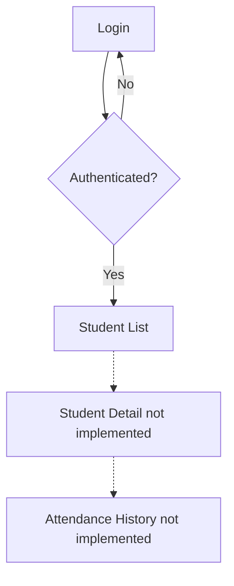
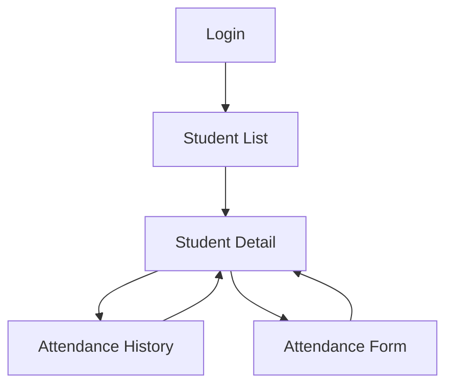

# UX Audit — Health Track

## 1. Project Information

- Application: Health Track
- Role: Trainer
- Screens: Student Detail and Attendance History
- Technology: React Native, Expo, TypeScript
- Checkpoint: CP1 — UX Audit

## 2. Current Situation

Health Track currently implements the Login and Student List screens.

The Student Detail and Attendance History screens are documented in `01-architecture/screens/`, but they are not implemented in the current mobile application.

Both screens require a `studentId` navigation parameter.

## 3. UX Findings

| Screen | Finding | UX Principle | Severity | Proposed Improvement |
|---|---|---|---|---|
| Student Detail | The screen is not implemented in the current application. | Navigation and accessibility | High | Implement StudentDetail and connect it to StudentList. |
| Student Detail | The student information cannot currently be consulted from a detail screen. | Information hierarchy | High | Display the student name and document number in a clear information card. |
| Student Detail | The loading state is specified but not implemented. | System status visibility | Medium | Display a skeleton card while student data loads. |
| Student Detail | The error and retry states are specified but not implemented. | Error recovery | High | Display a clear error message and retry button. |
| Attendance History | The history screen is not implemented or connected to navigation. | Navigation consistency | High | Add AttendanceHistory with the required studentId parameter. |
| Attendance History | The loading and empty states are documented but unavailable in the app. | System feedback | High | Add skeleton rows and an informative empty-state message. |
| Attendance History | Pull-to-refresh and pagination are specified but not implemented. | User control | Medium | Add list refreshing and pagination in groups of 20 records. |
| Both screens | Accessibility requirements remain unverified. | Accessibility | Medium | Verify accessible labels, touch targets, text scaling and WCAG AA contrast. |

## 4. Current Navigation

The dashed connections represent the intended navigation, not functioning routes.

The trainer cannot currently navigate from Student List to Student Detail or Attendance History.

## 5. Planned Navigation

The planned flow will allow the trainer to select a student, view basic information, and open their attendance history.

## 6. Screen States

### Student Detail

- Loading: skeleton card.
- Loaded: student name, document number and action buttons.
- Error: message with retry action.
- Offline with cache: saved data with an offline banner.
- Offline without cache: specific error message.

### Attendance History

- Loading: skeleton rows.
- Loaded: session cards with date, check-in, check-out and muscle groups.
- Empty: informative message.
- Error: message with retry action.
- Offline with cache: previously saved sessions with an offline banner.
- Offline without cache: specific error message.

## 7. Accessibility Checklist

- [ ] Verify accessible labels for interactive elements.
- [ ] Verify minimum touch target sizes.
- [ ] Verify text scaling.
- [ ] Verify WCAG AA contrast.
- [ ] Test layouts at 360 px and 768 px.

These checks remain pending until the screens are implemented.

## 8. Conclusion

The main UX limitation is the absence of Student Detail and Attendance History from the current implementation.

The next priorities are connecting the navigation routes, implementing the documented screen states and improving accessibility.
