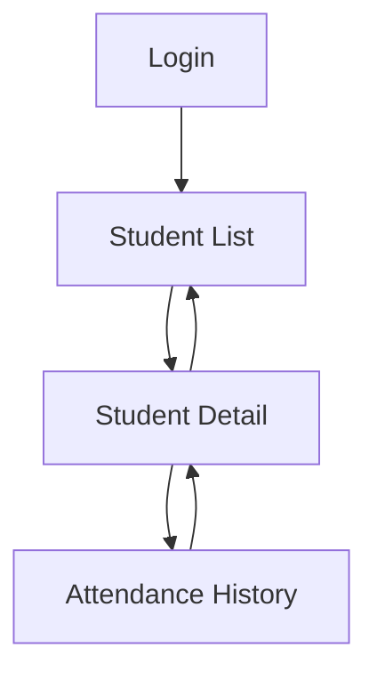

# Navigation and Design Tokens — Health Track

## 1. Project Information

- Application: Health Track
- Technology: React Native, Expo and TypeScript
- User role: Trainer
- Screens: Student Detail and Attendance History
- Checkpoint: CP2

## 2. Navigation Pattern

Health Track uses Stack Navigation with React Navigation.

This pattern was selected because the trainer follows a sequential workflow: first selecting a student, then reviewing their information, and finally accessing their attendance history.

The navigation uses the student's identifier (`studentId`) to maintain the correct context between screens.

### Navigation Flow

### Implemented Routes

| Route | Parameter | Purpose |
|---|---|---|
| Login | None | Trainer authentication |
| StudentList | None | Display registered students |
| StudentDetail | studentId | Display student detail screen |
| AttendanceHistory | studentId | Display the student's attendance history |

The Student Detail and Attendance History screens are connected through React Navigation.

## 3. Design Tokens

Design tokens are defined centrally in `src/core/theme/theme.ts`.

### Colors

| Token | Value | Usage |
|---|---|---|
| Primary | `#2E7D32` | Main buttons and navigation actions |
| On Primary | `#FFFFFF` | Text on primary buttons |
| Secondary | `#455A64` | Secondary elements |
| On Secondary | `#FFFFFF` | Text on secondary buttons |
| Success | `#2E7D32` | Success states |
| Error | `#B00020` | Error messages |
| Surface | `#FFFFFF` | Cards and content surfaces |
| Background | `#F5F5F5` | Main screen background |
| Text | `#1A1A1A` | Primary text |
| Text Muted | `#595959` | Supporting information |
| Border | `#E0E0E0` | Borders and separators |

### Typography

| Style | Size | Weight |
|---|---|---|
| Title | 22 | Bold |
| Body | 16 | Regular |
| Caption | 14 | Regular |

### Spacing

| Token | Value |
|---|---|
| xs | 4 |
| sm | 8 |
| md | 16 |
| lg | 24 |
| xl | 32 |

### Border Radius

| Token | Value |
|---|---|
| sm | 4 |
| md | 8 |
| pill | 999 |

## 4. Contrast Verification

The following color combinations are used by the interface:

| Foreground | Background | Contrast ratio | WCAG AA |
|---|---|---|---|
| `#FFFFFF` | `#2E7D32` | 5.13:1 | Pass |
| `#FFFFFF` | `#455A64` | 7.24:1 | Pass |
| `#1A1A1A` | `#FFFFFF` | 17.40:1 | Pass |
| `#595959` | `#FFFFFF` | 7.00:1 | Pass |
| `#1A1A1A` | `#F5F5F5` | 15.97:1 | Pass |

The target contrast ratio for normal text is at least 4.5:1.

## 5. Applied Improvements

- Added StudentDetail and AttendanceHistory navigation routes.
- Connected student cards to their detail screen.
- Added navigation from Student Detail to Attendance History.
- Preserved Health Track's green visual identity.
- Centralized additional secondary and success colors.
- Used touch targets with a minimum height of 48.
- Added accessible labels to navigation buttons.

## 6. Current Limitations

The application is being tested using a local demonstration mode because the backend is not running.

Student Detail currently shows the selected student's identifier. Full data loading remains pending.

Attendance History currently displays an empty list until its data service is implemented.

## 7. Conclusion

The navigation changes provide a direct workflow for trainers to access student details and attendance history.

The centralized design tokens help maintain consistent styles and support further accessibility improvements.
