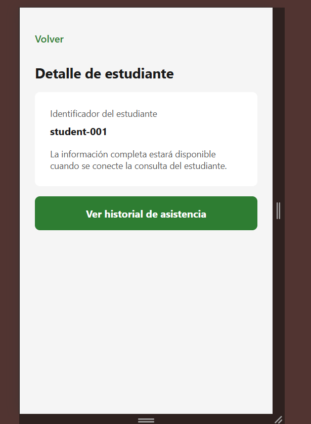
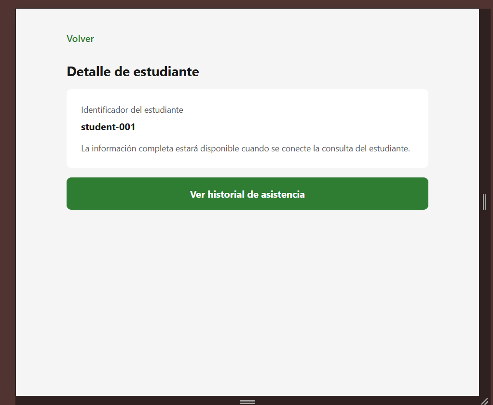
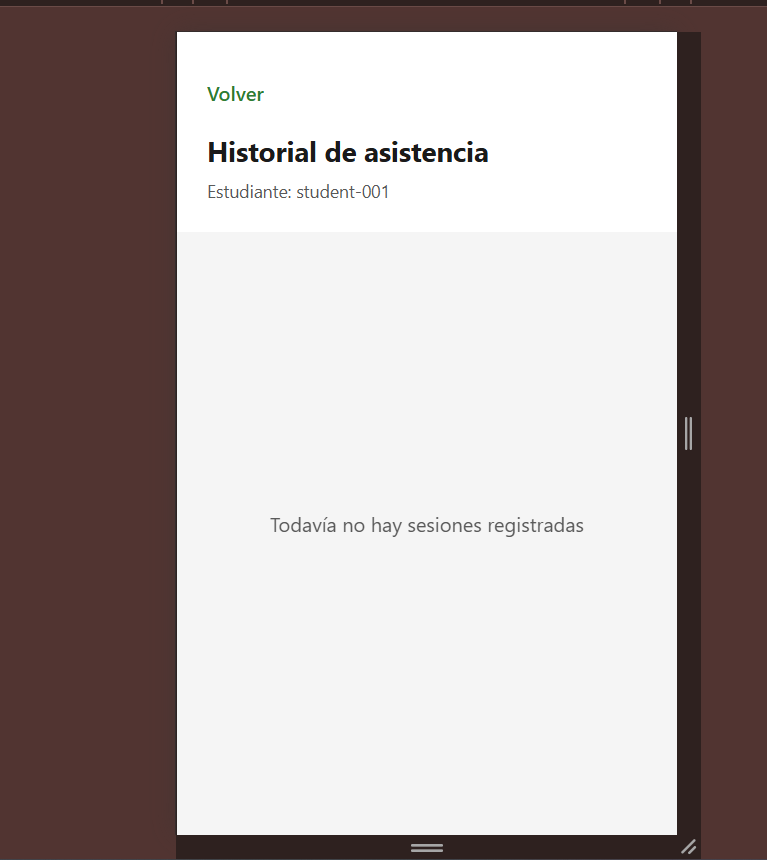
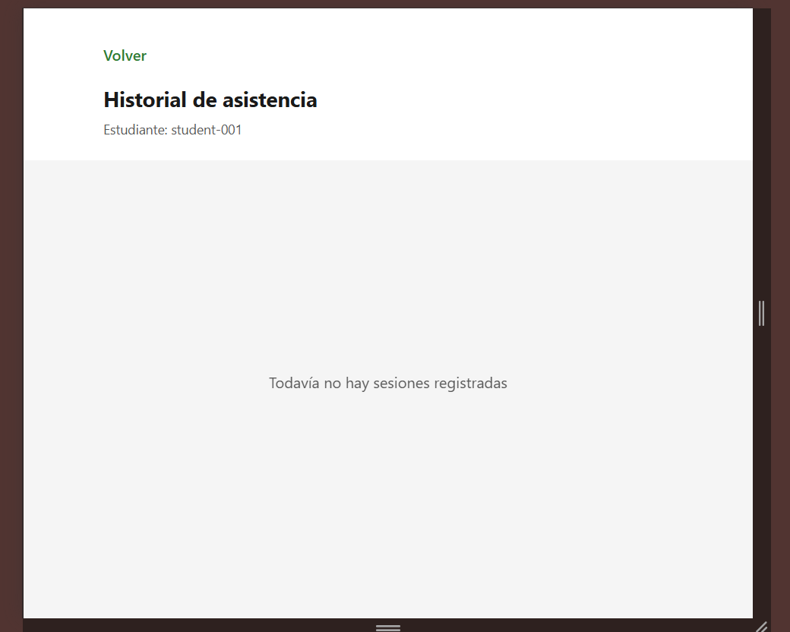

# CP4 — Accessibility and Responsive Design

## Project
Health Track — Week 11 UX/UI Workshop

## Assigned Screens
- Student Detail
- Attendance History

## Objective
Improve accessibility and responsive layout while preserving existing navigation and functionality.

## Accessibility Improvements

### Student Detail
- Added an accessible heading for the screen title.
- Added accessibility labels and hints to navigation buttons.
- Maintained a minimum button height of 48 pixels.
- Allowed the student identifier to be selected and copied.
- Preserved readable text and spacing.

### Attendance History
- Added an accessible heading for the screen title.
- Added accessibility labels and hints to navigation buttons.
- Maintained a minimum button height of 48 pixels.
- Preserved loading, empty, and error states.
- Maintained the retry button when an error occurs.

## Responsive Improvements
- Limited Student Detail content to a maximum width of 600 pixels.
- Centered the Student Detail content on wider screens.
- Limited Attendance History list content to a maximum width of 600 pixels.
- Centered the Attendance History header content on wider screens.
- Preserved full-width layouts on smaller screens.

## Responsive Evidence

### Student Detail — 360 px

### Student Detail — 768 px

### Attendance History — 360 px

### Attendance History — 768 px

## Verification
- TypeScript: `npx tsc --noEmit` — passed.
- Jest: `npm test` — 3 tests passed.
- Loading state — automated test passed.
- Empty state — automated test passed.
- Error and retry — automated test passed.
- Responsive layouts — visually reviewed in Chrome.

## Known Limitations
- Student Detail currently shows the student identifier rather than full student data.
- Attendance History currently uses a demonstration data source rather than a connected API.
- Automated tests still produce React `act(...)` environment warnings.
- A full automated accessibility audit has not yet been completed.

## Conclusion
The two assigned screens now have improved accessibility attributes and responsive layouts. Automated tests confirm the main attendance history states. Further work is required to connect the real API and complete accessibility auditing.
