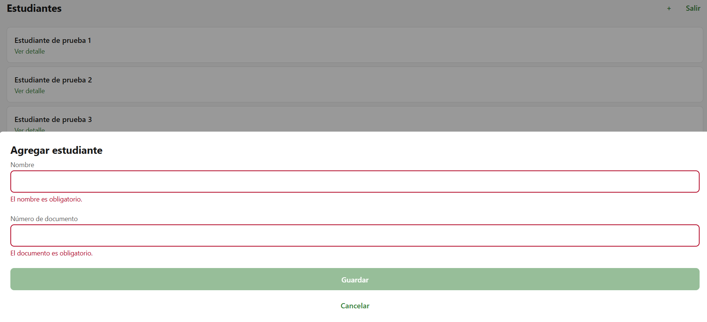
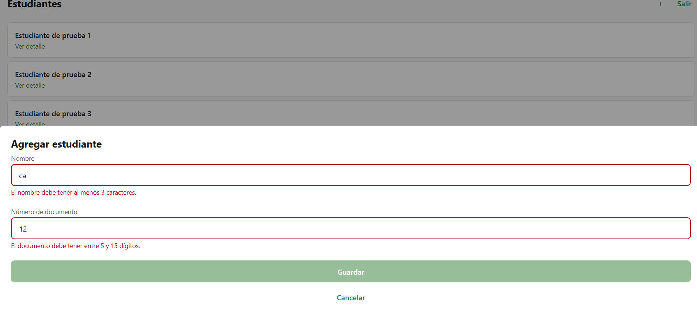
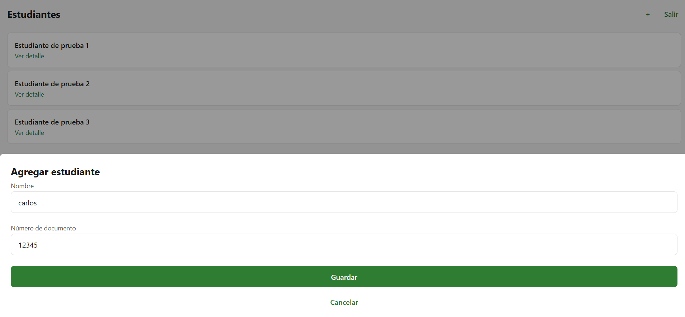
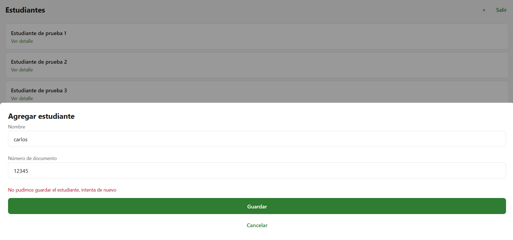

# CP6 — Student Registration Form

## Project
Health Track

## Form
Add Student

## Objective
Improve student registration through field validation, clear error messages, loading feedback, and confirmation before discarding changes.

## Validation Rules

| Field | Rule | Purpose |
|---|---|---|
| Name | Required | Prevent registration without a name |
| Name | Minimum 3 characters | Avoid incomplete names |
| Name | Maximum 80 characters | Limit excessively long entries |
| Document number | Required | Identify the student |
| Document number | Numbers only | Prevent invalid characters |
| Document number | Between 5 and 15 digits | Check document length |

These are workshop validation rules and still need verification against the backend requirements.

## Implemented Improvements

- Validation errors appear below each field.
- Invalid fields display red borders.
- The Save button is disabled when the form is invalid.
- A loading indicator is available during submission.
- Server errors are displayed clearly.
- Previous server errors are cleared when a field changes.
- A confirmation dialog is configured before discarding changes.
- A success message is implemented but has not been verified with a successful backend response.

## Screenshots

### Empty Form

### Validation Errors

### Valid Fields

### Server Error

## Verification Results

- TypeScript compilation: passed.
- Existing automated tests: 3 passed.
- Required fields: visually verified.
- Validation error messages: visually verified.
- Disabled Save button: visually verified.
- Server error message: visually verified.
- Successful registration: not verified.

## Pending Improvements

- Connect registration to a working backend.
- Verify the success notification after a successful submission.
- Verify cancellation confirmation behavior on web and mobile.
- Review validation rules against the real student data requirements.
