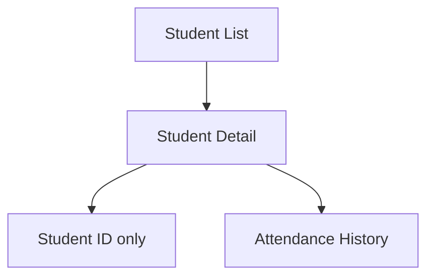
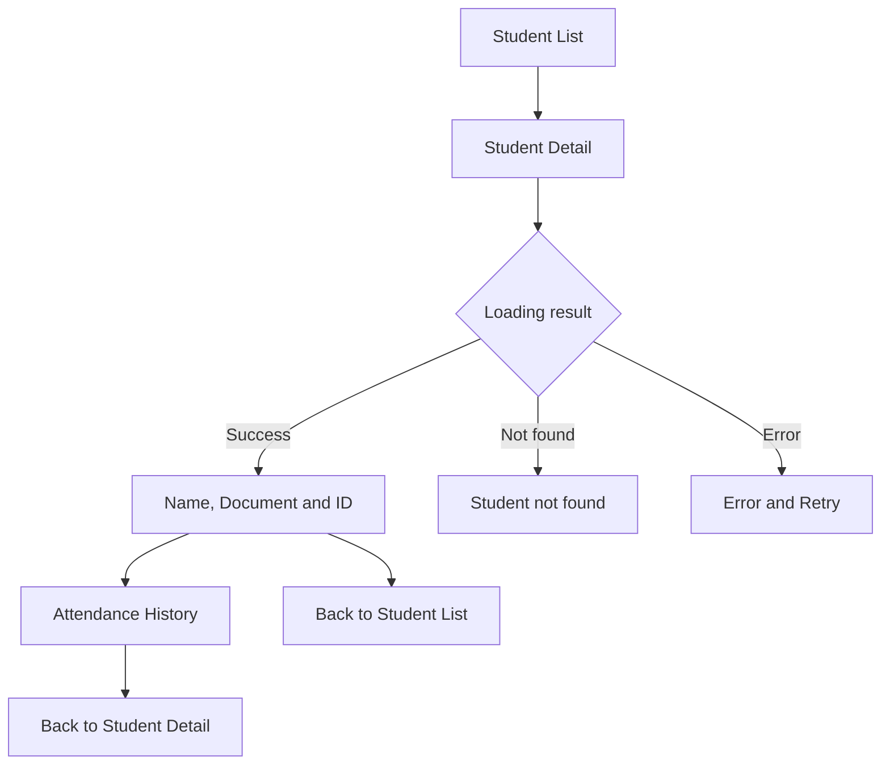
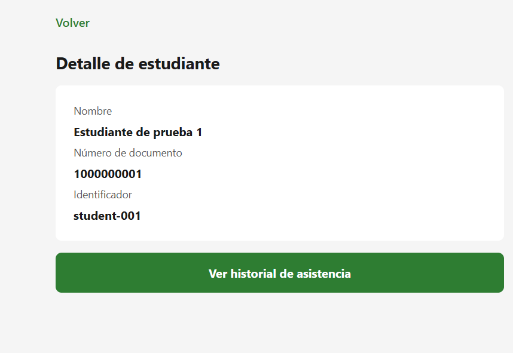

# CP7 — Student Detail and Navigation Flow

## Project
Health Track

## Objective
Improve the navigation from the student list to the student detail screen and attendance history.

## Navigation Flow

### Before

Previously, the student detail screen displayed only the student identifier and a message indicating that complete information was not available.

### After

## Implemented Changes

- The selected student ID is received through navigation parameters.
- Student information is retrieved using the existing student service.
- The detail screen shows the student's name, document number and ID.
- A loading indicator appears while the student data is being retrieved.
- A not-found message appears when the student does not exist.
- An error message and Retry button are available when the request fails.
- The existing navigation to attendance history is preserved.

## Evidence

### Student Detail

The screenshot shows the student name, document number, ID, and attendance history button in demonstration mode.

## Verification

- TypeScript compilation: passed.
- Existing automated tests: 3 passed.
- Student detail with demonstration data: visually verified.
- Loading, error and not-found states: implemented but not yet individually verified.
- Complete navigation to attendance history: pending manual verification.

## Limitations

The application uses demonstration students when `EXPO_PUBLIC_DEMO_MODE` is enabled. Real student data depends on the configured backend and available cache.
