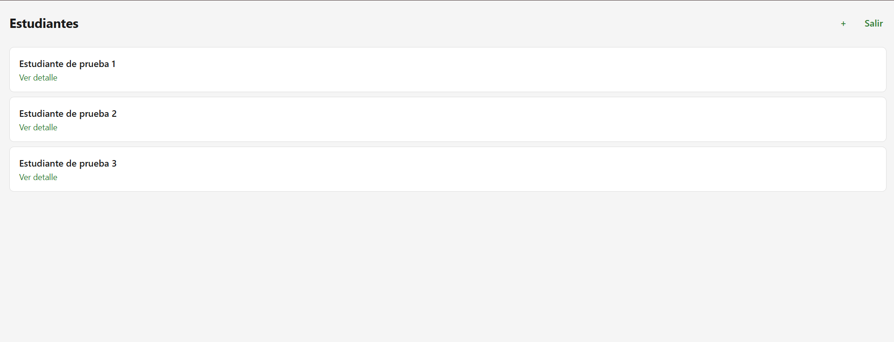
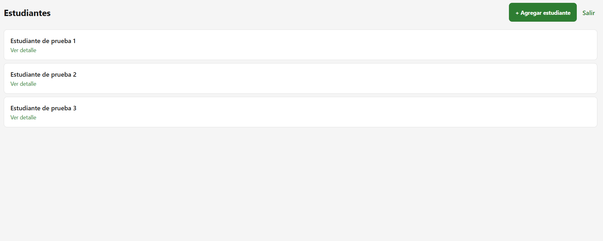

# CP9 — Before and After

## Project

Health Track

## Objective

Document the UX/UI improvements implemented during the Week 11 workshop, based on the initial interface review and feedback collected from two people.

## 1. Initial Situation

During the usability review, both participants described Health Track as an application that was generally easy to understand.

However, one difficulty was identified when trying to find the option for adding a student.

Originally, the Add Student action was represented only by a small plus symbol (+) in the upper-right area of the student list.

Although the button was functional, its purpose was not immediately clear to every user.

## 2. Before and After Comparison

| Before | After |
|---|---|
| Small plus-only button (+). | Green button labeled "+ Agregar estudiante". |
| The action depended on recognizing an icon. | The action is explained through visible text. |
| The button was difficult for one participant to notice. | The button is larger and visually more prominent. |
| The purpose was not immediately obvious. | The purpose is more clearly communicated. |

### Before — Original Interface

The original design used a small plus symbol to represent the Add Student action.

### After — Improved Interface

The updated design uses a larger green button with a descriptive label.

## 3. Reason for the Change

The improvement was based on feedback collected during the CP8 usability review.

Both participants considered the application understandable, but a difficulty was reported when locating the Add Student option.

The objective was not to change how student registration works, but to make the existing action easier to discover.

## 4. User Stories for the Team

### User Story 1 — Clear Student Registration Action

As a teacher, I want to easily identify the Add Student option so that I can open the registration form without searching for an unclear icon.

**Acceptance Criteria**

- The student list displays a visible button labeled "Agregar estudiante".
- The button includes a clear visual style and an appropriate touch target.
- Selecting the button opens the existing student registration form.
- The button respects the existing offline restriction.

### User Story 2 — Student Detail Information

As a teacher, I want to see the selected student's name, document number, and identifier so that I can confirm that I am viewing the correct student.

**Acceptance Criteria**

- Selecting a student opens the detail screen with the correct ID.
- The screen displays the student's name, document number, and identifier.
- A loading indicator appears while information is being retrieved.
- An appropriate message appears if the student is not found.
- A failed request displays an error and an option to retry.

### User Story 3 — Attendance History Navigation

As a teacher, I want to open a student's attendance history from their detail screen so that I can review attendance information without losing the selected student context.

**Acceptance Criteria**

- The student detail screen provides a visible attendance history button.
- Navigation passes the selected student's identifier.
- The attendance history shows a clear empty state when there are no sessions.
- The user can return to the previous screen.
- The navigation flow preserves the selected student context.

## 5. Verification

The following results were obtained during the workshop:

- TypeScript compilation completed without errors.
- The student detail screen displayed the demonstration student's name, document number, and identifier.
- Navigation from student detail to attendance history and back was manually verified.
- The improved Add Student button was visually verified.
- The improved Add Student button successfully opened the registration form.
- Before and after screenshots were saved.

The loading, request-error, and student-not-found states in the detail screen have been implemented but were not individually verified during the documented manual review.

## 6. Limitations

The initial usability review did not record task completion times or detailed error counts.

The updated Add Student button was functionally checked, but no second usability test was conducted to measure whether participants could locate it more quickly.

Backend-dependent operations still require verification with a working backend.

## 7. Conclusion

The Week 11 workshop helped identify an interface detail that could be improved without changing the application's existing functionality.

The Add Student button was changed from a small icon to a larger button with a descriptive label, responding to feedback received during usability testing.

The student detail and attendance history screens were also improved to provide clearer information, navigation, and feedback states.

These changes provide a starting point for further usability testing and implementation by the team.
